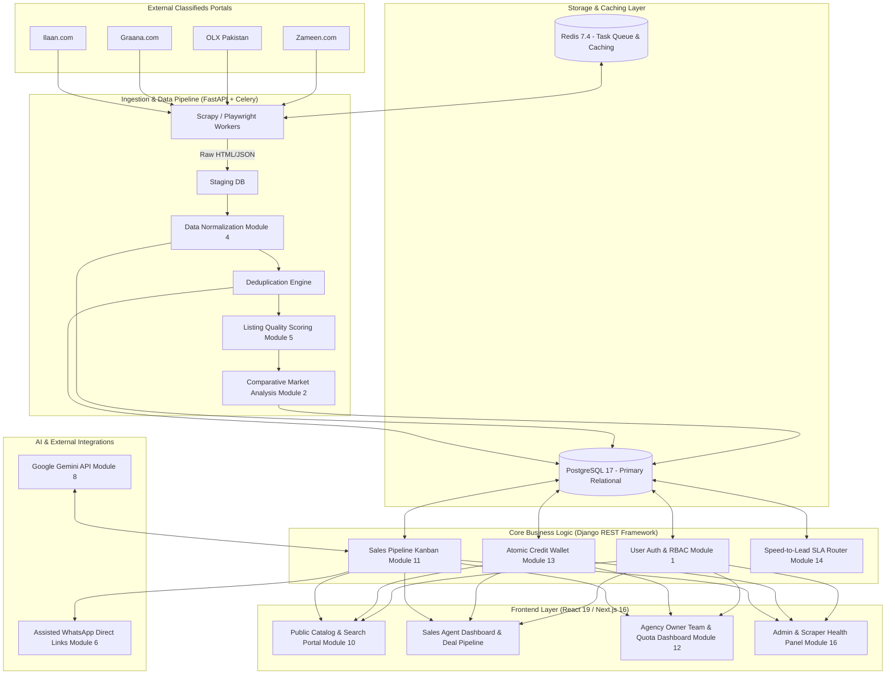
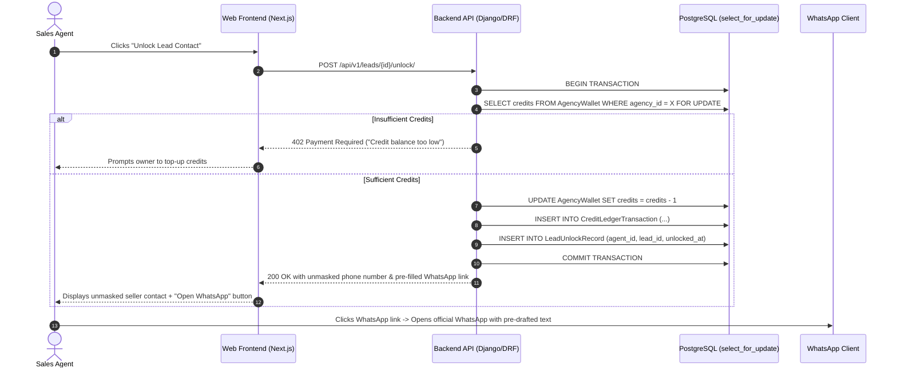

# LEADS: Project Handover & Technical Master Guide
**Platform Name:** LEADS (Lead generation Engine for Automated Discovery System)  
**Academic Context:** BS Software Engineering Final Year Project, COMSATS University Islamabad (CUI)  
**Authors:** Mamoon Tahir (`CIIT/FA23-BSE-051/ISB`), Muhammad Soban (`CIIT/FA23-BSE-056/ISB`)  
**Supervisor:** Dr. Tehseen Riaz Abbasi  
**Document Purpose:** Complete technical handover document for new developers, project contributors, and evaluators detailing project background, architectural evolution, all 17 modules, database blueprints, core workflows, and implementation next steps.

---

## Table of Contents
1. [Executive Summary & Core Concept](#1-executive-summary--core-concept)
2. [Evolutionary History: What Changed & Why (Critical Context)](#2-evolutionary-history-what-changed--why-critical-context)
3. [System Architecture & Technology Stack](#3-system-architecture--technology-stack)
4. [The 17 Modules Reference Guide](#4-the-17-modules-reference-guide)
5. [Core Data Pipelines & BTS Workflows](#5-core-data-pipelines--bts-workflows)
6. [Database Schema & Data Model Blueprint](#6-database-schema--data-model-blueprint)
7. [Repository Structure & Existing Codebase Guide](#7-repository-structure--existing-codebase-guide)
8. [FYP Viva & Evaluator Defense Strategy](#8-fyp-viva--evaluator-defense-strategy)
9. [Developer Roadmap & Next Implementation Steps](#9-developer-roadmap--next-implementation-steps)

---

## 1. Executive Summary & Core Concept

### What is LEADS?
LEADS is a B2B real estate lead discovery, market intelligence, and sales acceleration platform purpose-built for Pakistani real estate brokerage agencies and sales representatives.

### The Problem in Plain Terms
In the Pakistani property market, existing portals (Zameen.com, OLX Pakistan, Graana.com, and Ilaan.com) operate as **passive classifieds boards**:
- **Unstandardized & Fragmented Data:** A property in Islamabad may be listed in Marlas or Square Yards, with prices in Crore or Lac, and descriptions reading "call for price" or lacking utility information.
- **Duplicate Inventory:** Multiple agencies and sellers re-post the same property across different portals with varying prices and outdated statuses.
- **Zero Pricing Intelligence:** Public portals offer no micro-market benchmark. An agent cannot easily determine if an asking price is 15% above or below the rolling sector average without hours of manual checking.
- **Chaotic Internal Agency Operations:** Real estate agencies manage incoming leads through paper diaries, WhatsApp groups, or basic spreadsheets. Leads are contacted twice, response times exceed 24 hours, and agency owners have no visibility into agent productivity.

### The LEADS Solution
LEADS replaces this manual, disjointed process with an **active, automated data and sales pipeline**:
1. **Aggregates** public listings from multiple portals using scheduled, polite background workers.
2. **Normalizes** regional units (Marla/Kanal to SqFt; Lac/Crore to PKR numeric).
3. **Deduplicates** identical properties across portals into single canonical records.
4. **Scores Listing Quality** based on attribute completeness (utilities, rooms, documents).
5. **Computes Comparative Market Baselines (CMA)** (30-day rolling median price per Marla) to highlight below-market opportunities.
6. **Empowers Agency Sales Reps** with an atomic credit wallet, 1-click assisted WhatsApp outreach, a digital seller intake form (Module 7), and a Jira-style Kanban sales pipeline with a 30-minute response-time SLA.

---

## 2. Evolutionary History: What Changed & Why (Critical Context)

> [!IMPORTANT]
> If you are taking over this project, this section is vital. During early design phases, several assumptions were made that failed real-world tests or academic scrutiny. Understanding **why** these were discarded will save you from making critical mistakes in viva defense or architecture.

### Change 1: Dropped "Middleman Elimination" & "Direct-Owner Classifier"
* **The Old Idea:** The early draft claimed: *"LEADS uses Machine Learning to filter out all middleman brokers and isolate verified direct property owners."*
* **Why It Failed (The Real-World Test):**
  1. **Private Developers & Society Builders:** In Pakistan, developers buy land, build a housing society or commercial plaza, and sell 20 to 50 plots/units. Under a naive "multi-listing = broker" rule, genuine owners are falsely marked as brokers.
  2. **Open Mandates are Standard:** Property owners regularly give open mandates to 4 or 5 local agencies to sell their house. The same property appearing 5 times is normal business practice, not fraudulent spoofing.
  3. **No Land Registry API:** Software scraping OLX cannot legally verify title deeds without access to Punjab Land Records Authority (PLRA), FBR, or Patwari land revenue records.
  4. **The Core Contradiction:** **LEADS is built for real estate agencies!** Agencies and sales agents *are* intermediaries. A platform cannot market itself to brokers while claiming that brokers are a scam to be eliminated.
* **The New Implementable Solution:** Replaced with **Listing Quality and Completeness Scoring** (Module 5). The system scores listings on whether they provide complete covered area, room counts, utility availability, and verifiable contact formats, filtering out garbage/incomplete ads rather than claiming to police human identity.

---

### Change 2: Replaced "Deal Discovery" with "Lead Discovery"
* **The Old Phrase:** Earlier drafts used the term *"Automated Deal Discovery"*.
* **Why It Was Rejected:** In real estate terminology, a **"deal"** is an executed legal closing involving token money (*biyana*), contract signing, title transfer, and commission payout. Software cannot "discover deals mid-way." Software discovers **listings** and generates prospective buyer/seller **leads**. The deal itself is negotiated and closed by human agents.
* **The New Standard:** The platform is strictly described as **"Lead Discovery, Listing Aggregation, and Sales Pipeline Management"**.

---

### Change 3: Replaced Risky Automated WhatsApp Bot with Assisted 1-Click WhatsApp Direct Links
* **The Old Idea:** Blasting automated marketing messages to scraped phone numbers via the WhatsApp Cloud API.
* **Why It Failed:** Scraping a phone number from OLX and immediately firing an automated WhatsApp Business API message violates Meta's Commerce & Anti-Spam Policy. The business number will get permanently banned within 24 to 48 hours, and WhatsApp Cloud API charges per-conversation fees.
* **The New Implementable Solution:** **Assisted 1-Click WhatsApp Links** (`https://wa.me/<phone>?text=<encoded_draft>`). The platform pre-drafts a personalized property outreach template. The agent clicks the button, which directly opens the agent's own installed WhatsApp Web or mobile application. This ensures human-in-the-loop compliance, incurs zero API costs, and prevents phone number bans.

---

### Change 4: Replaced Real-Time Live Scraping with Scheduled Batch Ingestion
* **The Old Idea:** Launching 5 live scraping workers in parallel every time a user executes a search on the website.
* **Why It Failed:** Pakistani classifieds (Zameen, OLX, Graana) employ Cloudflare, PerimeterX, and CAPTCHAs. Launching real-time scraping bots on user clicks causes requests to timeout (>30 seconds) and triggers immediate IP rate-limiting.
* **The New Implementable Solution:** Scheduled asynchronous background ingestion (Celery Beat running during off-peak hours) with rotating proxies and polite request delays (1.5s per request). Ingested listings are normalized and indexed into PostgreSQL/Redis, allowing user search queries to execute in **under 350 milliseconds**.

---

### Change 5: Replaced Blind LLM Valuations with Statistical CMA
* **The Old Idea:** Asking an LLM (Gemini/OpenAI) to directly guess the price of a property from a text description.
* **Why It Failed:** LLMs hallucinate localized Pakistani property prices without statistical grounding.
* **The New Implementable Solution:** Clear division of labor:
  - **Statistical CMA Engine (Module 2):** Calculates real mathematical 30-day rolling median price per Marla from scraped database records for specific sectors (e.g., G-13, DHA Phase 2).
  - **Google Gemini API (Module 8):** Used strictly for NLP text parsing (extracting features from seller intake forms) and generating professional English marketing descriptions.

---

### Change 6: Expanded from 12 Bundled Modules to 17 Separation-of-Concerns (SOC) Modules
* **The Old Structure:** 12 modules where single modules handled both data ingestion, normalization, and CRM.
* **The New Standard:** 17 modular services strictly separated by operational boundaries, with zero parentheses and zero analogies in their names.

---

### Change 7: Academic Report Table Formatting Requirement
* **The Guideline:** Academic BSSE report standards require **100% pure white backgrounds (`#FFFFFF`)** for all table cells, **pure black text (`#000000`)**, crisp black borders (`#000000`), and zero decorative blue/colored fills. Both deliverable `.docx` files have been generated to enforce this rule strictly.

---

## 3. System Architecture & Technology Stack



### Technology Justifications

| Component | Technology | Version | Engineering Rationale |
| :--- | :--- | :--- | :--- |
| **Frontend Framework** | Next.js / React | Next 16, React 19 | Fast server-side rendering for public property SEO; rich client-side dashboard state. |
| **Styling** | Tailwind CSS | v4.0 | Rapid responsive UI component design without bulky external component stylesheets. |
| **Backend Business Logic** | Django + DRF | Python 3.13 | Robust built-in ORM, secure authentication, session handling, and clean relational modeling. |
| **Data Engine & API** | FastAPI | v0.115+ | High-throughput asynchronous endpoints for scraper workers and analytical calculations. |
| **Primary Database** | PostgreSQL | v17 | ACID compliance, row-level locks (`SELECT FOR UPDATE`) for atomic credit wallet deductions. |
| **Task Queue & Cache** | Redis + Celery | Redis 7.4, Celery 5.4 | Distributed asynchronous job processing (Scrapy workers, scheduled CMA recalculation). |
| **Scraping Frameworks** | Scrapy + Playwright | Scrapy 2.12, Playwright 1.50 | Scrapy for high-speed static HTML; Playwright for JavaScript-rendered portals with proxy rotation. |
| **Generative AI / NLP** | Google Gemini API | 1.5 / 2.0 Flash | Structured JSON schema output for property attribute extraction and professional description drafting. |
| **Containerization** | Docker & Compose | Modern Compose v2 | Reproducible multi-service deployment (Postgres, Redis, Web, Celery Worker, Celery Beat). |

---

## 4. The 17 Modules Reference Guide

The system is architected around **17 distinct Separation-of-Concerns (SOC) modules**:

| Module ID | Module Title | Core Responsibility | Key Technologies |
| :--- | :--- | :--- | :--- |
| **Module 1** | **User Authentication and Role-Based Access Control** | Handles signup, login, OTP verification via SMS/Email, JWT sessions, and RBAC across 4 roles: Agency Owner, Sales Agent, Property Buyer, System Administrator. | Django Auth, SimpleJWT, Redis |
| **Module 2** | **Market Intelligence and Price Benchmark Engine** | Continuously calculates 30-day rolling median price per Marla across urban sectors; flags properties priced $\ge 15\%$ below sector baseline. | Python, Pandas, PostgreSQL |
| **Module 3** | **Multi-Platform Property Scraping Engine** | Scheduled background scraping workers extracting property specifications and external image links from Zameen, OLX, Graana, and Ilaan. | Scrapy, Playwright, Rotating Proxies |
| **Module 4** | **Data Normalization and Deduplication Engine** | Converts regional land units (Marla, Kanal, SqYds) into uniform SqFt; converts Lac and Crore into numeric PKR; merges identical cross-portal ads via text fingerprinting. | Python regex, Levenshtein distance |
| **Module 5** | **Listing Quality and Completeness Scoring Engine** | Evaluates attribute completeness (covered area, price, bedrooms, utilities) and assigns an objective 0–100 quality score; filters low-quality entries from the primary feed. | Python scoring service |
| **Module 6** | **Assisted Seller Outreach Module** | Formats contextual message drafts containing property details and generates 1-click WhatsApp web links (`wa.me`) for agents to initiate contact safely. | Web URL encoder, WhatsApp Web protocol |
| **Module 7** | **Seller Property Intake Form System** | Provides a lightweight, category-specific web form sent to sellers to collect structured specs: utility connections (gas, electricity), construction year, and legal documents. | Next.js dynamic forms, S3/Cloudinary |
| **Module 8** | **Property Analysis and Marketing Content Engine** | Uses Google Gemini API to parse unstructured seller intake text into structured database fields and generate standardized marketing property descriptions. | Google Gemini API (structured output) |
| **Module 9** | **Buyer Requirement Matching Engine** | Ingests buyer property requests (budget, sector, bedrooms) and runs weighted scoring algorithms to match them with active property inventory. | PostgreSQL query indexing, Python matcher |
| **Module 10** | **Public Property Catalog and Search Portal** | Fast public-facing property directory with faceted search filters (city, sector, price, size, quality rating), bookmarking, and requirement submission forms. | Next.js Server Components, Tailwind CSS |
| **Module 11** | **Agent Sales Pipeline and Lead Management Module** | Visual Kanban board for sales agents to manage leads across stages: *New Lead, Contacted, Viewing Scheduled, Offer Made, Closed Won / Lost*. | React DnD / @hello-pangea/dnd, DRF |
| **Module 12** | **Agency and Team Management Module** | Administrative console for Agency Owners to invite agents via unique single-use tokens, manage seat licenses, and monitor team activity. | Django Admin / Custom Owner Dashboard |
| **Module 13** | **Internal Credit Wallet and Quota System** | Agency-level prepaid credit wallet with atomic database locks (`select_for_update`) preventing concurrency race conditions when agents unlock leads. | PostgreSQL transaction isolation |
| **Module 14** | **Sales Performance and Activity Tracking Module** | Speed-to-lead response timer tracking agent contact latency; automated 30-minute reassignment rule; gamified agency sales leaderboard. | Celery Beat, Redis TTL, WebSockets |
| **Module 15** | **Agency Analytics Dashboard** | Aggregated business intelligence for agency owners: total unlocked leads, pipeline conversion rates, active deals value, and agent responsiveness charts. | Chart.js / Recharts, Django Aggregations |
| **Module 16** | **System Administration and Scraper Health Monitor** | System administrator panel monitoring worker uptime, proxy pool latency, extraction error rates, and security audit logs. | Flower (Celery monitor), DRF logging |
| **Module 17** | **User Profile and Notification System** | User settings, communication preferences, password management, and automated email/in-app notifications for matching buyer leads and price drops. | Celery, SMTP, WebSockets |

---

## 5. Core Data Pipelines & BTS Workflows

### Pipeline 1: Ingestion to Listing Discovery
1. **Extraction (Celery Beat):** Scraper worker nodes fetch public listings off Zameen, OLX, Graana, and Ilaan at scheduled off-peak intervals. Only external image URLs are stored to prevent server storage bloat.
2. **Normalization (Module 4):**
   $$\text{Area in SqFt} = \begin{cases} \text{Marla} \times 225 & \text{(or 272 based on local society registry)} \\ \text{Kanal} \times 4500 \\ \text{Square Yards} \times 9 \end{cases}$$
   $$\text{Price in PKR} = \begin{cases} \text{Crore} \times 10,000,000 \\ \text{Lac} \times 100,000 \end{cases}$$
3. **Deduplication:** A composite hash of `(city, normalized_sector, property_type, normalized_area, price_bracket)` detects identical listings. If multiple records match, a single `CanonicalListing` is created with merged attributes.
4. **Quality Scoring (Module 5):** Calculated based on attribute presence:
   $$\text{Score} = (\text{Has Area} \times 20) + (\text{Has Price} \times 20) + (\text{Has Bed/Bath} \times 20) + (\text{Has Images} \ge 3 \times 20) + (\text{Has Phone} \times 20)$$
5. **CMA Baseline Calculation (Module 2):** Computes rolling 30-day median price per Marla for each urban sector. If $\text{Listing Price per Marla} \le 0.85 \times \text{Sector Median}$, the listing is tagged with a `Below Market Opportunity` badge.

---

### Pipeline 2: Atomic Lead Unlock & Assisted Outreach


---

### Pipeline 3: Speed-to-Lead SLA & Auto-Reassignment
1. When an agent unlocks a lead, an SLA tracking record is created in Redis with a **30-minute expiration window** (`ttl = 1800s`).
2. The agent is required to update the lead status to *Contacted* or click the WhatsApp outreach link.
3. If no interaction is recorded within 30 minutes:
   - Celery Beat triggers the `reassign_stale_leads` worker.
   - The inactive agent receives a compliance penalty on the sales leaderboard.
   - The lead is automatically reassigned to the next highest-ranked active agent in the agency.
   - The Agency Owner receives an alert notification summarizing the reassignment.

---

## 6. Database Schema & Data Model Blueprint

Below is the relational data model blueprint for PostgreSQL / Prisma:

```prisma
// User & Multi-Tenancy Core
model User {
  id            String       @id @default(uuid())
  email         String       @unique
  phoneNumber   String       @unique
  passwordHash  String
  role          UserRole     // AGENCY_OWNER, SALES_AGENT, BUYER, ADMIN
  agencyId      String?
  agency        Agency?      @relation(fields: [agencyId], references: [id])
  leadCards     LeadCard[]
  unlocks       LeadUnlock[]
  createdAt     DateTime     @default(now())
}

model Agency {
  id            String       @id @default(uuid())
  name          String
  ownerId       String       @unique
  wallet        CreditWallet?
  agents        User[]
  inviteTokens  AgencyInviteToken[]
  createdAt     DateTime     @default(now())
}

model CreditWallet {
  id            String       @id @default(uuid())
  agencyId      String       @unique
  agency        Agency       @relation(fields: [agencyId], references: [id])
  balance       Int          @default(0)
  transactions  CreditTransaction[]
  updatedAt     DateTime     @updatedAt
}

model CreditTransaction {
  id            String       @id @default(uuid())
  walletId      String
  wallet        CreditWallet @relation(fields: [walletId], references: [id])
  amount        Int          // e.g. -1 for unlock, +50 for purchase
  type          String       // UNLOCK, PURCHASE, QUOTA_ALLOCATION
  agentId       String?
  createdAt     DateTime     @default(now())
}

// Listing Ingestion & Normalization
model CanonicalListing {
  id              String       @id @default(uuid())
  title           String
  description     String?
  propertyType    String       // HOUSE, FLAT, PLOT, COMMERCIAL
  city            String
  sector          String
  normalizedArea  Float        // In Square Feet
  pricePkr        Decimal      // In Pakistani Rupees
  pricePerMarla   Decimal
  qualityScore    Int          @default(0) // 0 to 100
  imageUrls       String[]
  rawSourceUrls   String[]
  sellerPhone     String
  isBelowMarket   Boolean      @default(false)
  leadCards       LeadCard[]
  createdAt       DateTime     @default(now())
}

// Sales Pipeline & Kanban Management
model LeadCard {
  id              String       @id @default(uuid())
  listingId       String
  listing         CanonicalListing @relation(fields: [listingId], references: [id])
  agentId         String
  agent           User         @relation(fields: [agentId], references: [id])
  stage           LeadStage    // NEW_LEAD, CONTACTED, VIEWING, OFFER, CLOSED_WON, CLOSED_LOST
  unlockedAt      DateTime     @default(now())
  firstContactAt  DateTime?
  isReassigned    Boolean      @default(false)
  notes           LeadNote[]
}

enum UserRole {
  AGENCY_OWNER
  SALES_AGENT
  BUYER
  ADMIN
}

enum LeadStage {
  NEW_LEAD
  CONTACTED
  VIEWING_SCHEDULED
  OFFER_MADE
  CLOSED_WON
  CLOSED_LOST
}
```

---

## 7. Repository Structure & Existing Codebase Guide

The project repository (`/home/soban-iftikhar/Projects/LEADS/`) is organized into two primary sections: documentation deliverables and application source code:

```text
/home/soban-iftikhar/Projects/LEADS/
│
├── Docx/                                       # Official FYP Report Deliverables & Scope
│   ├── Final Report Template_FA_26(BSSE Program).docx  # Official University injected report
│   ├── LEADS_Complete_FYP_Report.docx          # Complete identical master thesis deliverable
│   ├── LEADS_Final_Report_Ch1_Ch2.docx         # Standalone Chapter 1 & 2 deliverable
│   ├── LEADS_Scope_Document.pdf                # Original initial scope proposal
│   └── template_repaired.docx                  # Clean CUI template base with native styles
│
├── leads-app/                                  # Full-Stack Application Repository
│   ├── app/                                    # Next.js 16 App Router (Client & API routes)
│   ├── prisma/                                 # Prisma schema and database migrations
│   │   ├── schema.prisma                       # Database entity definitions
│   │   └── migrations/                         # Historical SQL migrations
│   │
│   ├── python-service/                         # Ingestion, Scrapers, and Celery Workers
│   │   ├── leads_scraper/                      # Scrapy spiders (Zameen, OLX, Graana)
│   │   ├── cleaning/                           # Text normalization & deduplication routines
│   │   ├── ml/                                 # Quality scoring & pricing analytics
│   │   ├── celery_app.py                       # Celery application initialization
│   │   ├── tasks.py                            # Async task definitions (scraping, CMA, SLA)
│   │   └── requirements.txt                    # Python dependencies
│   │
│   ├── services/                               # Application business logic services
│   ├── socket-server/                          # WebSocket real-time leaderboard server
│   └── src/                                    # Shared UI components & utilities
│
├── docker-compose.yml                          # Container configuration (Postgres, Redis, App)
├── README.md                                   # Repository introduction
└── PROJECT_HANDOVER_GUIDE.md                   # THIS DOCUMENT
```

### How to Run the Development Stack
1. **Prerequisites:** Docker, Docker Compose, Node.js 20+, Python 3.13.
2. **Start Infrastructure Services (PostgreSQL & Redis):**
   ```bash
   cd /home/soban-iftikhar/Projects/LEADS
   docker compose up -d postgres redis
   ```
3. **Start Python Background Workers (Celery):**
   ```bash
   cd leads-app/python-service
   source venv/bin/activate
   pip install -r requirements.txt
   celery -A celery_app worker --loglevel=info
   ```
4. **Start Next.js Frontend & API Server:**
   ```bash
   cd leads-app
   npm install
   npx prisma migrate dev
   npm run dev
   ```
   Open `http://localhost:3000` in your web browser.

---

## 8. FYP Viva & Evaluator Defense Strategy

When presenting this project to the supervisor (**Dr. Tehseen Riaz Abbasi**) or external examiners, use these rock-solid answers:

| Expected Viva / Defense Question | The Perfect Answer to Give |
| :--- | :--- |
| **Q1: "Why don't you directly verify if the seller is the legal owner?"** | *"In Pakistan, verifying legal land ownership requires access to government land revenue records (PLRA/Patwari or FBR) which are not accessible via public APIs. Furthermore, developers sell multiple plots and owners hire multiple agencies. Instead of making unrealistic claims about proving human identity, LEADS focuses on **Listing Quality and Completeness Scoring** (checking covered area, room counts, utility connections, and valid phone numbers) and cross-platform deduplication."* |
| **Q2: "Aren't real estate agents middlemen? Why would they use your platform?"** | *"LEADS is a B2B platform **built specifically for real estate agencies**. Agents waste 15 to 20 hours each week manually browsing 4 different portals to find inventory. LEADS aggregates this inventory, standardizes the pricing per Marla, and provides an internal CRM with credit wallets and a 30-minute contact SLA to help the agency manage their own team efficiently."* |
| **Q3: "How do you avoid getting banned when scraping Zameen and OLX?"** | *"We do not perform real-time scraping on every user click. We use scheduled Celery batch workers running during off-peak hours with request throttling (1.5s delay) and proxy rotation. User searches query our locally indexed PostgreSQL/Redis database in under 350ms without hitting external portals."* |
| **Q4: "Why not use WhatsApp Cloud API bots to message sellers automatically?"** | *"Blasting cold messages to scraped numbers via the Cloud API violates Meta's Anti-Spam Policy and leads to permanent number termination within 48 hours. LEADS uses **Assisted 1-Click WhatsApp Direct Links** where the system generates the pre-filled template, but the licensed sales agent initiates the chat from their official WhatsApp application. This is safe, human-in-the-loop, and incurs zero API cost."* |
| **Q5: "How does the Comparative Market Analysis (CMA) calculate prices?"** | *"It calculates the 30-day rolling median price per Marla for active listings in specific residential sectors (e.g., G-13 or DHA Phase 2). It provides a relative benchmark indicator to identify properties listed significantly below prevailing asking rates, rather than claiming to be a certified bank appraisal."* |

---

## 9. Developer Roadmap & Next Implementation Steps

If you are taking over the codebase to complete the next stages of development, follow this prioritized checklist:

### Stage 1: UI Mockups & Screen Alignment (High Priority)
- [ ] Create Figma mockups for screens **M1 through M8** strictly matching the specifications in Section 2.6 of the report.
- [ ] Export mockup images and insert them into the blank figure boxes (`Figures 2.2 through 2.9`) in `Final Report Template_FA_26(BSSE Program).docx`.

### Stage 2: Database & Backend Implementation
- [ ] Update `leads-app/prisma/schema.prisma` to incorporate the multi-tenancy tables: `Agency`, `CreditWallet`, `CreditTransaction`, and `LeadCard` (Kanban stages).
- [ ] Implement the `POST /api/v1/leads/{id}/unlock/` endpoint using atomic transaction locking (`select_for_update`) to prevent concurrent credit deduction race conditions.
- [ ] Configure the Celery Beat task in `python-service/tasks.py` for the 30-minute Speed-to-Lead SLA monitor to automatically reassign neglected leads.

### Stage 3: Data Ingestion & Quality Engine
- [ ] Refine the Scrapy spiders in `leads-app/python-service/leads_scraper/` to target specific sectors in Islamabad/Rawalpindi.
- [ ] Implement the unit normalization functions (`Marla` $\rightarrow$ `SqFt`, `Lac/Crore` $\rightarrow$ `PKR`) in `python-service/cleaning/`.
- [ ] Implement the 0–100 quality scoring formula (Module 5) to tag complete versus incomplete listings.

### Stage 4: Report Progression (Chapters 3 & 4)
- [ ] **Chapter 3 (Architecture & High-Level Design):** Develop Activity Diagrams, Sequence Diagrams for the 4 actors, and the Architectural Diagram based on the mermaid blueprint in this document.
- [ ] **Chapter 4 (Implementation & Testing):** Document code snippets, unit test results, and performance benchmarks (<350ms search latency, bcrypt work factor 12).
